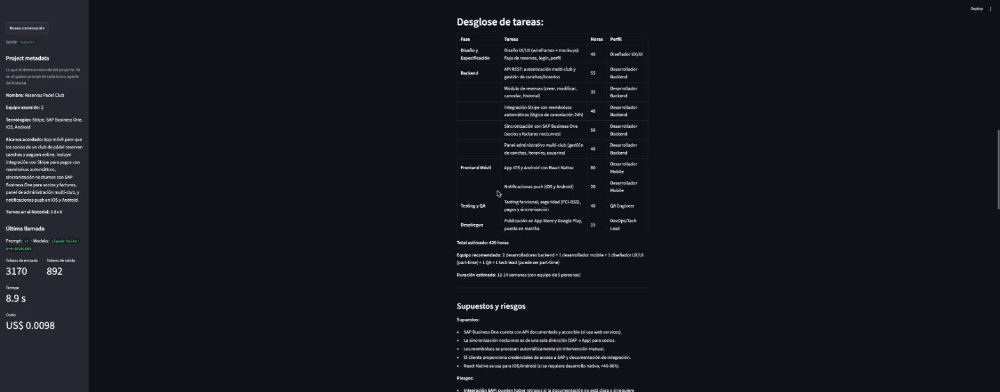

# Estimador CAG

API hecha con FastAPI con un formulario en Streamlit.
Recibe la descripción de un proyecto junto con el tipo, el nivel de detalle y el formato que se quiere, y devuelve una estimación (tareas, horas, equipo y duración) generada con Claude.

El prompt ya no lo escribe la persona. El formulario manda solo los parámetros y el backend arma el prompt con plantillas de Jinja2 versionadas.

Desde la sesión 5 la estimación es una conversación: se crea una sesión, se pueden mandar varios mensajes sobre el mismo proyecto y adjuntar PDFs o documentos Word. El sistema recuerda los datos del proyecto entre turnos sin reenviar toda la conversación.

## Requisitos

- Python 3.11+
- uv
- API key de Anthropic

## Cómo correrlo

```
uv sync
cp .env.example .env
```

Poner la API key en el .env (ANTHROPIC_API_KEY), junto con LLM_PROVIDER=anthropic y LLM_MODEL=claude-haiku-4-5, y después:

```
uv run uvicorn app.main:app --reload
```

La documentación queda en http://localhost:8000/docs

## Probar

```
curl -X POST http://localhost:8000/api/v1/estimate \
  -H "Content-Type: application/json" \
  -d '{"description": "Una app para reservar canchas de padel con pagos y recordatorios", "project_type": "mobile_app", "detail_level": "medium", "output_format": "phases_table"}'
```

Opciones de cada campo:

- project_type: mobile_app, web_saas, internal_tool, data_pipeline
- detail_level: summary, medium, detailed
- output_format: phases_table, line_items, narrative
- description: entre 20 y 2000 caracteres
- reference_projects (opcional): hasta 5 proyectos parecidos, cada uno con name y hours. Por ejemplo `[{"name": "Portal de clientes", "hours": 400}]`

La versión del prompt se elige en la URL, con `?prompt_version=v1` o `?prompt_version=v2`. Si no se manda, se usa v1.

Si algo no cumple, la API responde 422 y no llama al modelo.

## Conversación con memoria y adjuntos (sesión 5)

Primero se crea una sesión:

```
curl -X POST http://localhost:8000/sessions
{"session_id": "36ef0e8a-a7da-41be-a400-a16b04e5cade"}
```

Después cada mensaje va a `POST /sessions/{session_id}/estimate` como multipart/form-data, con la transcripción, los mismos selectores del formulario y los adjuntos que se quieran:

```
curl -X POST http://localhost:8000/sessions/36ef0e8a-a7da-41be-a400-a16b04e5cade/estimate \
  -F project_type=mobile_app -F detail_level=summary -F output_format=line_items \
  -F "transcript=Te paso los requisitos técnicos que nos mandaron." \
  -F "attachments=@tests/fixtures/requisitos.pdf"
```

La respuesta trae lo mismo que antes (texto, modelo, tokens y costo) y además el project_metadata actualizado, cuántos turnos hay en el historial y el costo de la llamada que actualiza el metadata.
Si la sesión no existe (por ejemplo porque se reinició la API) responde 404, y si el adjunto no es .pdf ni .docx responde 415.

El endpoint de antes, `POST /api/v1/estimate`, sigue igual.

### Historial y memoria

Son dos cosas distintas y viven separadas en `app/sessions.py`:

- ConversationHistory: los mensajes que viajan a la API en cada llamada. Usa ventana deslizante: guarda los últimos MAX_TURNS turnos (6 por defecto, se cambia en el .env) y cuando se pasa borra el par pregunta y respuesta más viejo. El system prompt no se guarda ahí, se arma de nuevo en cada turno con `to_messages_list()` y siempre va primero.
- ProjectMetadata: lo que sabemos del proyecto (nombre, equipo asumido, tecnologías mencionadas y alcance acordado). Va dentro de `<project_metadata>` en el system prompt de cada turno. Así, aunque la ventana borre los primeros mensajes, el modelo no se olvida del nombre del proyecto.

Las sesiones están en un diccionario en la memoria del proceso. Si se reinicia la API se pierden. Para esta etapa alcanza, más adelante se puede pasar a Redis o a una base de datos.

### Adjuntos: camino B (extracción local)

El texto se saca en el servicio, con pypdf para los PDF y python-docx para los Word, y se pega a la transcripción con un separador `--- attachment: requisitos.pdf ---`.

Elegí este camino porque no depende del proveedor (el mismo código sirve con Anthropic o con OpenAI), se puede ver y probar exactamente qué texto le llega al modelo, y es el mismo paso que después hace falta para partir documentos en el RAG del módulo 3.
Lo malo es que se pierden las imágenes y los diagramas, y un PDF escaneado no tiene texto (en ese caso se avisa en el prompt). Cada archivo se corta en 20.000 caracteres para no llenar el contexto.

### Cómo se actualiza el project_metadata

Con un LLM extractor: después de cada respuesta se hace una segunda llamada al modelo con el metadata que teníamos, el mensaje del usuario y la respuesta, y devuelve un JSON con los campos de ProjectMetadata (plantilla `app/prompts/metadata_extractor.j2`).

Lo elegí en vez de regex porque los datos vienen en lenguaje libre ("seríamos tres", "lo haremos en Flutter") y una regex se rompe con cualquier forma distinta de decirlo. Con Haiku la segunda llamada cuesta menos de medio centavo por turno.
En la primera prueba el extractor anotaba como "mencionadas" tecnologías que solo había propuesto el estimador, así que el prompt ahora pide solo las que dijo el usuario o vienen en los adjuntos.
Si el extractor falla o devuelve algo que no es JSON, se queda el metadata anterior y la estimación se entrega igual.

## Formulario con Streamlit

Con la API corriendo, en otra terminal:

```
uv run streamlit run streamlit_app.py
```

Se abre en http://localhost:8501 (la API se configura con API_URL en el .env, por defecto http://localhost:8000).

Al abrir la página se crea una sesión. Cada envío es un turno de la conversación: la transcripción o un cambio ("¿y si somos 2 personas?"), los selectores y, si hay, PDFs o documentos Word.
En la barra lateral está el project_metadata actual, cuántos turnos hay en el historial y los datos de la última llamada. El botón "Nueva conversación" crea otra sesión y empieza de cero.



En la captura, el primer turno describe la app, el segundo adjunta `requisitos.pdf` (Stripe, SAP Business One, 3 clubes) y el total sube de 315 a 420 horas, y el tercero pregunta por 2 desarrolladores: las horas siguen en 420 y solo cambia la duración.

## Prompts

Los prompts están en app/prompts/estimation, una carpeta por versión:

- v1/system.j2: rol, reglas, un bloque según el formato y otro según el nivel de detalle, en la conversación el bloque `<project_metadata>` (vacío en el primer turno), y al final los ejemplos
- v1/user.j2: el tipo de proyecto, la descripción dentro de `<project_description>` y, si vienen, los proyectos de referencia (un `` que escribe una línea por proyecto)
- v1/examples.j2: las estimaciones de ejemplo (contexto CAG)
- v2/: igual que v1, pero pide las horas como rango (mínimo y máximo) en vez de un número fijo

Para probar un cambio en el prompt se crea una carpeta nueva en vez de tocar la que funciona, y se comparan las dos con el mismo formulario.

app/prompts/loader.py junta todo con `render_estimation_prompt(request, version="v1")` y devuelve el system y el user por separado.
Usa StrictUndefined, así que si a una plantilla le falta una variable da error en vez de mandar el prompt con un hueco.

Cada vez que arma un prompt deja una línea en el log con structlog:

```
[info     ] prompt_rendered    prompt_hash=e62955a35cb9 version=v2
```

El hash es una huella del prompt final. Si cambia una sola coma, cambia el hash, así se puede saber con qué prompt exacto salió cada estimación.

## Tests

```
uv run pytest
```

Revisan la estructura de carpetas, /health, /docs y el endpoint de estimación (con una respuesta falsa para no gastar créditos, y que rechace datos inválidos con 422).

En tests/prompts/test_estimation_v1.py están los tests de las plantillas. No llaman a ninguna API y tardan milisegundos:

- la descripción aparece tal cual dentro de `<project_description>`
- con phases_table el system trae el encabezado de la tabla y con narrative no
- con detailed se piden los supuestos de cada fase y con summary no
- van los dos ejemplos y no quedan líneas en blanco de más

En tests/prompts/test_estimation_v2.py, que la v2 pide rangos y la v1 no, que el `` escribe cada proyecto de referencia (y nada si no hay), y que el log trae la versión y el hash.

En tests/test_sessions.py están los de la sesión 5, con httpx.AsyncClient y un LLM falso que guarda lo que se le mandó:

- dos turnos en la misma sesión: el project_metadata se completa sin perder lo anterior, y el segundo system prompt ya trae el nombre del proyecto
- el mismo mensaje con y sin `tests/fixtures/requisitos.pdf`: con el PDF cambia la estimación y el texto del PDF llega al modelo después del separador
- 8 turnos en la misma sesión: al modelo nunca le llegan más de MAX_TURNS y los mensajes más viejos ya no están
- una sesión que no existe da 404 y un adjunto .txt da 415

También corren en GitHub Actions en cada push.

## Estructura

- app/main.py: crea la app y el endpoint /health
- app/config.py: lee las variables del .env
- app/schemas.py: lo que entra (EstimationRequest) y lo que sale (EstimationResponse)
- app/routers/estimations.py: endpoint POST /api/v1/estimate
- app/routers/sessions.py: POST /sessions y POST /sessions/{session_id}/estimate
- app/sessions.py: Session, ConversationHistory (ventana deslizante) y ProjectMetadata
- app/prompts/loader.py: arma el system y el user prompt desde las plantillas
- app/prompts/estimation/v1/ y v2/: plantillas del prompt, una carpeta por versión (turn.j2 es el mensaje de cada turno de la conversación)
- app/services/llm_service.py: llama a Claude y calcula el costo
- app/services/attachments.py: saca el texto de los PDF y Word
- app/services/session_service.py: un turno de la conversación y la llamada que actualiza el metadata
- app/prompts/metadata_extractor.j2: prompt del extractor
- streamlit_app.py: la conversación con Streamlit
